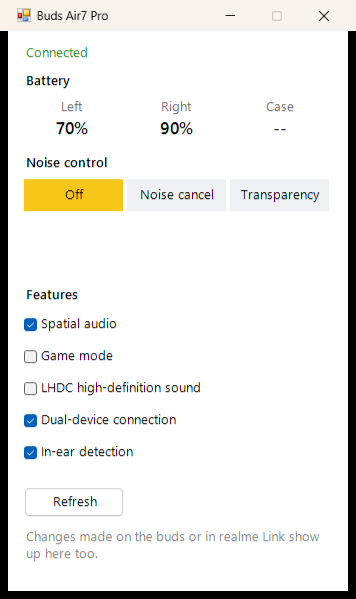
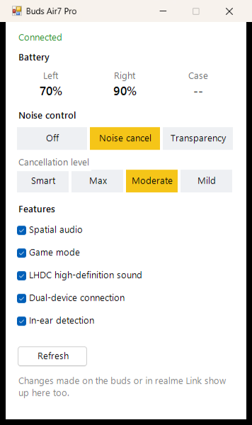

# realme Buds Air7 Pro Control for Windows

A small Windows app to control **realme Buds Air7 Pro** from a PC: noise control, ANC level,
spatial audio, game mode, LHDC, dual-device connection and in-ear detection. No phone or
realme Link app needed.

<p>
  
  &nbsp;&nbsp;
  
</p>

## Features

- **Battery**: left, right and case, refreshed every minute
- **Noise control**: Off / Noise cancellation / Transparency
- **ANC level**: Smart, Max, Moderate, Mild
- **Spatial audio**, **Game mode**, **LHDC high-definition sound**
- **Dual-device connection** and **In-ear detection** (auto play/pause)
- Stays in sync: changes made on the buds or in realme Link show up in the app too

## Requirements

- Windows 10 or 11 with Bluetooth
- realme Buds Air7 Pro paired with and **connected to** the PC
  (turn on *Dual-device connection* to keep them connected to your phone at the same time)

## Usage

1. Download or clone this repository.
2. Double-click **`Buds Control.vbs`**.

The window connects to the buds automatically and reconnects if they drop.
To launch it like a normal app, create a shortcut to `Buds Control.vbs` on your Desktop or in the Start menu.

## How it works

realme Link talks to the buds over a classic Bluetooth serial channel (RFCOMM, service UUID
`0000079a-d102-11e1-9b23-00025b00a5a5`). I captured the app's traffic with Android's Bluetooth
HCI snoop log and decoded the protocol. The app opens the same channel with a Windows Bluetooth
socket and sends the same commands.

### Frame format

```
AA | len | 00 00 | op | type | seq | payloadLen (2 bytes, LE) | payload
```

- `len`: number of bytes after the length byte (7 + payload length)
- `type`: `01` get, `04` set, `81`/`84` reply from the buds, `02`/`05` event from the buds
- `seq`: incremented by the sender; replies carry the same value

### Commands

| Function | Request | Values |
|---|---|---|
| Battery | `06 · 01` (get) | reply: `00 <count> (<id> <percent>)…`, id 1 left, 2 right, 3 case |
| Noise mode (read) | `0C · 01` `01 01` | reply: `00 01 01 <value>` |
| Noise mode / ANC level (set) | `04 · 04` `01 01 <value>` | `01` off, `02` transparency, `08` noise cancel (Max), `20` Smart, `10` Moderate, `04` Mild |
| Feature on/off (set) | `03 · 04` `<id> <0/1>` | ids below |
| Feature states (read) | `0D · 01` `<count> <ids…>` | reply: `00 <count> (<id> <value>)…` |

| Feature | id |
|---|---|
| Spatial audio | `1B` |
| Game mode | `06` |
| LHDC (buds reconnect after changing it) | `18` |
| Dual-device connection | `11` |
| In-ear detection | `04` |

Events from the buds: `04 · 02` `03 01 01 <value>` when the noise mode changes,
`04 · 02` `01 <count> (<id> <percent>)…` for battery updates, `04 · 02` `05 <0/1>` for game mode.

## Tools

The `tools` folder has the scripts I used to work out the protocol:

- `capture.ps1`: pulls a bug report from an Android phone over adb, extracts `btsnoop_hci.log`
  and lists the realme frames. Needs Android
  [platform-tools](https://developer.android.com/tools/releases/platform-tools) in a
  `platform-tools` folder and *Bluetooth HCI snoop log* set to *Enabled* in Developer options.
- `decode-btsnoop.ps1`: decodes a `btsnoop_hci.log` (L2CAP, ATT, RFCOMM) into a readable timeline.

Captures can contain personal data from your phone, so `captures/` is excluded from git.

## Disclaimer

This is an unofficial project and is not affiliated with or endorsed by realme.
Use at your own risk.
